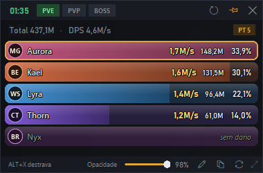

# DPS Meter BDO

Medidor de dano (**DPS meter**) para **Black Desert**: uma janelinha por cima do jogo que mostra
quanto de dano cada pessoa da sua pt está causando: DPS, dano total, porcentagem e classe.



*(imagem de exemplo, com nomes fictícios)*

> **Leia o [aviso sobre riscos](#riscos-leia-antes-de-usar) antes de usar.** Ferramentas de
> terceiros que leem dados do jogo são proibidas pelos termos de uso da Pearl Abyss.

---

## Como baixar e instalar (passo a passo)

1. **Baixe** o arquivo **[DPS-Meter-BDO.zip](https://github.com/Lucas-Amaralz/DPS-Meter-BDO/releases/latest/download/DPS-Meter-BDO.zip)**
   (ou pelo site: **https://lucas-amaralz.github.io/DPS-Meter-BDO**).
2. **Extraia** o .zip (botão direito → *Extrair tudo...*) para onde quiser, por exemplo *Documentos*.
   Não tire o `DPSMeterBDO.exe` de dentro da pasta.
3. **Abra o `DPSMeterBDO.exe`.**
   - Se o Windows mostrar *"O Windows protegeu o computador"*: clique em **Mais informações** →
     **Executar assim mesmo**. (Acontece com programas que não são de uma empresa grande.)
4. **Na primeira vez**, se aparecer a faixa dourada **"Npcap não instalado: CLIQUE AQUI"**, clique nela.
   O meter baixa o instalador oficial do [Npcap](https://npcap.com) (o mesmo que o Wireshark usa para
   ler a rede) e abre para você. Clique em **I Agree → Install → Finish**. O meter reinicia sozinho.
5. Pronto! Entre no jogo. Para aparecerem os **nomes e classes** da pt, entre na pt (ou troque de
   canal) **com o meter aberto**.

Requisitos: Windows 10 ou 11, 64 bits.

**Atualização:** o programa procura versões novas sozinho e, quando sai uma, mostra um **aviso verde**
no topo da janela. Ele só instala quando você clica no aviso (ALT+X e clique), nunca no meio de uma
luta, e mantém seus nomes, histórico e configurações.

---

## Como usar

| O que fazer | Como |
|---|---|
| Destravar a janela para mexer nela | **ALT+X** (a borda fica dourada) |
| Travar de novo | **ALT+X** ou esperar 15 segundos |
| Mover / redimensionar | arraste a barra de cima / o canto de baixo à direita |
| Zerar a contagem | botão de setas ↻ em cima, com dois cliques (zerar, reiniciar e fechar pedem confirmação) |
| Copiar o ranking (para colar no chat/Discord) | botão de copiar no rodapé |
| Renomear alguém, marcar "Sou eu" | botão direito no nome |
| Opacidade | barrinha no rodapé |
| Zerar sem destravar | **ALT+Z** |
| Alternar entre PVE e BOSS | **ALT+B** |

**A janela é "fantasma":** com ela travada, o mouse passa direto para o jogo e ela **nunca** rouba o
teclado (seu WASD continua funcionando). Você pode deixá-la em cima da tela.

### Modos

- **PVE** (padrão): monstros normais. Pausas de mais de 5 s sem golpes não contam, e o DPS de cada um
  usa só o tempo em que a pessoa estava batendo.
- **BOSS**: boss e dungeon. Conta só o dano em **boss e sub-bosses** (monstros a partir de 3 milhões
  de vida; adds e mobs comuns ficam de fora). A luta **começa sozinha** no primeiro golpe da pt num boss,
  o tempo é a luta inteira e, quando o boss morre, **o tempo pausa** e aparece um **resumo** (tempo, DPS
  da pt e de cada um), com botões para copiar e voltar à tela normal. Cada luta fica no **histórico**
  (botão de relógio no rodapé). Durante a luta aparece a vida do boss e o tempo estimado para
  ele morrer; no resumo, o recorde de tempo contra aquele boss, quem bateu o próprio recorde de
  DPS, o dano que cada um recebeu e as mortes. Ao zerar, trocar de modo ou fechar o meter, a contagem
  atual também vai para o histórico (em PVE e BOSS), então nenhuma luta se perde.
- **PVP**: dano **entre jogadores** perto de você (duelo, arena, guerra de nó), com dano causado,
  dano recebido e abates/mortes.

Trocar de modo zera a contagem.

### Limitações

- O jogo só envia ao seu computador o que acontece **perto de você**. Quem está batendo longe
  aparece como "sem dano".
- Em PVE/BOSS só aparecem **você e a sua pt**.
- Nomes e classes chegam quando a pessoa **entra na pt** ou **aparece perto** com o meter aberto.
- Se uma atualização do jogo mudar o formato dos dados, o meter pode parar de contar até ser atualizado.

---

## Riscos (leia antes de usar)

**Existe risco.** Os termos de uso da Pearl Abyss proíbem programas de terceiros que leem dados do jogo,
e isso inclui este meter. A Pearl Abyss pode punir contas que usem ferramentas assim. **Use por sua conta
e risco**, de preferência testando antes numa conta secundária.

O que dá para dizer é **por que o risco de detecção é baixo**, porque o meter é **100% passivo**:

| O meter... |
|---|
| **Não** abre, lê nem altera a memória do jogo |
| **Não** injeta código nem se "acopla" ao processo do BDO |
| **Não** mexe em nenhum arquivo do jogo |
| **Não** envia nada ao servidor nem altera pacotes |
| **Não** automatiza nenhuma ação (não é bot nem macro) |
| Só **lê cópias** do tráfego de rede que já chega ao seu PC (como o Wireshark) |
| Só pergunta ao Windows quais conexões o jogo abriu (como o `netstat`) |
| Usa um atalho global comum do Windows (o mesmo tipo do Discord/OBS) |

Para o jogo e para o servidor, nada no seu comportamento muda. Mesmo assim, "difícil de detectar" não é
"permitido": as formas mais comuns de alguém ser punido por meters em MMOs são **denúncias** e
**prints publicados**. Evite postar prints do meter publicamente.

---

## Como funciona (o que foi feito, passo a passo)

O projeto foi feito por **engenharia reversa do tráfego de rede**, sem tocar no jogo:

1. **Captura.** O meter descobre (pela tabela de conexões do Windows) com quais endereços o
   `BlackDesert64.exe` conversa e grava só esses pacotes, com o [Npcap](https://npcap.com) e o
   [Scapy](https://scapy.net). Funciona com e sem ExitLag (com ExitLag, o jogo conecta num proxy
   local `127.0.0.1`).
2. **Formato das mensagens.** O fluxo é uma sequência de mensagens no formato
   `[tamanho 2 bytes][flag 1 byte][tipo 2 bytes][conteúdo]`. As mensagens que o **servidor envia** vêm
   **abertas** (flag `0`); as que o cliente envia vêm cifradas (flag `1`) e não são usadas.
3. **Achando o dano.** Com capturas controladas (usar uma skill por vez, anotar o horário, bater em
   bonecos), comparamos o que acontecia no jogo com o que passava pela rede:
   - **`0x0f4e`**: atualização de vida (de monstros e de jogadores): quem causou, alvo, vida nova e vida máxima.
   - **`0x16bc`**: resultado de golpes, com quem bateu, alvo, **dano exato** e vida que sobrou.
     Em algumas áreas é a única fonte.
   - O dano de cada golpe vem da queda de vida do alvo; golpes já contados pela `0x16bc` são
     descontados da outra mensagem, para nada contar duas vezes.
   - **Validação:** num boss de 50 milhões de vida, a soma do dano bateu com a vida perdida
     (diferença < 1%).
4. **Pt, nomes e classes.**
   - **`0x1b46`**: lista completa da pt (nome, família, classe, nível), quando você entra na pt.
   - **`0x0ed5`**: ficha de quem entra na pt.
   - **`0x0bd5`**: estado da pt a cada ~10 s (quem está nela, inclusive longe), usado para saber
     quem entrou/saiu.
   - **`0x1771`**: perfil de jogadores que aparecem perto (nome).
5. **Quem é você.** Algumas mensagens o servidor só manda sobre o próprio jogador (`0x141e`, `0x1c4b`);
   o meter junta esses sinais numa "votação" e se ajusta sozinho quando o seu ID muda (troca de canal).
6. **Classes.** O código de classe do jogo é o mesmo número usado no
   [site oficial](https://www.sa.playblackdesert.com/GameInfo/Class); os ícones são baixados de lá
   no seu PC na primeira abertura (não vão junto no programa).
7. **Janela.** Feita em Tkinter, marcada no Windows como **não ativável** (não rouba o foco do jogo) e
   **transparente para o mouse** quando travada.

---

## Privacidade

- O meter **não envia nada para lugar nenhum**. Tudo fica na pasta dele.
- Ele salva, ao lado do programa: um resumo de cada sessão (`capturas\...\resumo.txt`), a lista de golpes,
  e os nomes/classes que já viu (para reconhecer as pessoas depois). Pode apagar quando quiser.
- O tráfego bruto **não é gravado** na versão .exe.

---

## Para quem quer rodar pelo código

```powershell
python -m venv .venv
.venv\Scripts\python.exe -m pip install -r requirements.txt
meter.bat                                   # abre o meter (precisa do Npcap)
powershell -File empacotar\build.ps1        # gera o .zip com o .exe
```

| Arquivo | O que é |
|---|---|
| `meter.py` | o meter (captura, cálculo do dano, janela) |
| `capture.py` | captura de tráfego usada nas descobertas (com roteiro guiado por bipes) |
| `analyze.py` | diagnóstico de uma captura (entropia, formato, dano) |
| `empacotar/` | ícone do programa, LEIA-ME e script que gera o .exe |
| `docs/` | o site de download |

Também dá para repetir uma captura gravada: `meter.py --replay capturas\<pasta>`.

---

## Créditos

Ícones de classe © Pearl Abyss (baixados do site oficial no PC de cada usuário).
Black Desert é marca da Pearl Abyss; este projeto não tem relação com a Pearl Abyss.
